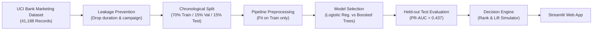

# CampaignIQ — Banking Customer Decision Intelligence

> **Smarter customer outreach through predictive analytics.**

[](https://www.python.org/)
[](https://streamlit.io/)
[](https://scikit-learn.org/)
[](https://docs.pytest.org/)
[](https://archive.ics.uci.edu/dataset/222/bank+marketing)
[](https://creativecommons.org/licenses/by/4.0/)

CampaignIQ is an educational decision-intelligence prototype that analyzes historical retail banking marketing campaigns and demonstrates how pre-contact predictive customer prioritization compares with uniform random targeting.

---

## The Business Problem

Financial institutions invest substantial relationship manager and call-center resources contacting retail banking customers about term deposits. Contacting every customer uniformly is inefficient, expensive, and leads to customer outreach fatigue.

CampaignIQ addresses this operational challenge by estimating each customer's subscription propensity **strictly before** a contact attempt is made. By ranking prospects based on pre-contact indicators, institutions can concentrate limited outreach capacity on the most receptive customers.

---

## Project Preview


---

## Quick Start — Run Anywhere in 60 Seconds

The repository includes pre-computed, lightweight model artifacts (`artifacts/`) so reviewers can clone and launch the interactive simulator immediately without waiting for datasets to download or models to train.

### Option 1: macOS & Linux (Bash / Zsh)

```bash
# 1. Clone repository
git clone https://github.com/<your-username>/CampaignIQ.git
cd CampaignIQ

# 2. Create and activate virtual environment
python3 -m venv venv
source venv/bin/activate

# 3. Install dependencies
pip install -r requirements.txt

# 4. Launch interactive simulator
streamlit run app.py
```

### Option 2: Windows (PowerShell / Command Prompt)

```powershell
# 1. Clone repository
git clone https://github.com/<your-username>/CampaignIQ.git
cd CampaignIQ

# 2. Create and activate virtual environment
python -m venv venv
.\venv\Scripts\Activate.ps1
# (or if using Command Prompt: venv\Scripts\activate.bat)

# 3. Install dependencies
pip install -r requirements.txt

# 4. Launch interactive simulator
streamlit run app.py
```

> **Port Notice:** Streamlit will automatically assign an available port (defaults to `http://localhost:8501`, or increments to `8502+` if 8501 is occupied) and automatically open the application in your default browser.

---

## One-Click Cloud Deployment (Streamlit Community Cloud)

This repository is structured for zero-configuration public hosting on **Streamlit Community Cloud**:

1. Fork or push this repository to your GitHub account.
2. Sign in to [share.streamlit.io](https://share.streamlit.io/) using your GitHub account.
3. Click **"New app"**, select your repository (`CampaignIQ`), branch (`main`), and set the main file path to:
   ```
   app.py
   ```
4. Click **"Deploy"**. The app will be live with a public URL in under 2 minutes.

*All dependencies in `requirements.txt` are version-pinned and headless-ready; no API keys, secrets, or external database configurations are required.*

---

## What I Built

1. **Leakage-Safe Data Ingestion:** Automated download, schema validation, and processing of the official 41,188-record UCI Bank Marketing dataset. Strictly removed call duration (`duration`) and in-campaign contact counts (`campaign`) to enforce 100% pre-contact feature purity.
2. **Chronological Splitting Strategy:** Evaluated on a chronological split (70% train / 15% validation / 15% test) reflecting genuine banking operations and uncovering macroeconomic regime shifts between 2008 and 2010.
3. **Dual Model Benchmarking:** Implemented and compared an interpretable linear baseline (Regularized Logistic Regression) against a gradient boosted tree ensemble (`HistGradientBoostingClassifier`). Logistic Regression was selected as the champion based on superior validation PR-AUC and calibration.
4. **Decision Intelligence Engine:** A reusable module (`src/decision_engine.py`) translating predicted probabilities into operational outreach metrics: Precision-at-K, random baseline expectation, and Lift-at-K.
5. **Single-Page Decision Simulator:** A minimalist financial-analytics dashboard built with Streamlit and Plotly that allows executives and analysts to simulate varying contact budgets interactively.

---

## Key Experimental Results

All reported metrics are computed on the untouched, held-out chronological test cohort ($N = 6,179$):

| Evaluation Dimension | Metric | Score | Analytical Takeaway |
| :--- | :--- | :---: | :--- |
| **Ranking Performance** | **Average Precision (PR-AUC)** | **0.4371** | Primary evaluation metric; robust to positive class imbalance. |
| | **ROC-AUC** | **0.5592** | Global pairwise concordance across positive and negative pairs. |
| **Decision Engine (20% Budget)** | **Customers Contacted ($K$)** | **1,236 / 6,179** | Selected top 20% by predicted deposit propensity. |
| | **Observed Positives in Top $K$** | **527** | Actual depositors identified in prioritized cohort (**42.64% precision**). |
| | **Random Expected Positives** | **475.3** | Positives expected under uniform random contact (**38.45% baseline**). |
| | **Outreach Lift** | **1.11x** | Concentrates +52 net positive outcomes over random expectation. |
| **Decision Engine (5% Budget)** | **Precision-at-5% / Lift** | **51.46% / 1.34x** | Under high capacity constraint, delivers 1.34x concentration over baseline. |
| **Classification Benchmark** | **Balanced F1 Score** | **0.4844** | Precision: 45.16%, Recall: 52.23% (at validation threshold 0.696). |
| | **Naive Majority Accuracy** | **61.55%** | A naive zero-rule classifier achieves 61.55% accuracy while finding zero deposits. |
| **Calibration** | **Brier Score** | **0.3352** | Mean squared error between predicted probabilities and observed binary outcomes. |

---

## System Architecture



---

## Reproducing Experiments & Running Tests

### Run Full Test Suite

The project includes 19 automated tests covering data parsing, leakage exclusion, chronological ordering, pipeline stability, and edge cases in the decision engine:

```bash
python -m pytest -v
```

### Reproduce Entire Pipeline from Scratch

To re-download the official UCI dataset, train both candidate models, select the champion, evaluate test metrics, and regenerate all artifacts:

```bash
python scripts/reproduce.py
```

---

## Technical Methodology

- **Feature Availability Point:** Modeled strictly prior to telephone contact. Demographic (`age`, `job`, `marital`), historical account (`poutcome`, `pdays`), and macroeconomic indicators (`euribor3m`, `cons.price.idx`) were included. Features occurring during or after the call (`duration`, `campaign`) were strictly excluded.
- **Chronological Split vs. Random K-Fold:** The dataset is chronologically ordered from May 2008 to November 2010. Chronological splitting avoids look-ahead contamination and exposed a dramatic macroeconomic regime shift: positive deposit rates rose from 5.57% (2008) to 38.45% (late 2010) as Euribor rates collapsed from 4.85% to <1.0% during the European debt crisis.
- **Algorithm Comparison:** Complex non-linear gradient boosting overfit the early macroeconomic regime, achieving only 0.1442 validation PR-AUC. Regularized Logistic Regression generalized significantly better (0.1870 validation PR-AUC, lower Brier score) and was selected as champion.
- **Decision Engine Formulas:**
  - $K = \text{round}(N \times \text{outreach\_ratio})$
  - $\text{Precision@K} = \frac{\text{Observed Positives in Top } K}{K}$
  - $\mathbb{E}[\text{Random Positives}] = K \times \text{Baseline Prevalence}$
  - $\text{Lift@K} = \frac{\text{Precision@K}}{\text{Baseline Prevalence}}$

*For comprehensive mathematical formulations, see [`docs/methodology.md`](docs/methodology.md).*

---

## Limitations

1. **Historical Portuguese Dataset:** Records span 2008–2010 from a Portuguese retail bank during the Eurozone debt crisis. Findings cannot be directly mapped to contemporary institutions or emerging retail banking environments without local retraining.
2. **Observational Rather Than Causal Uplift:** Every customer in this historical cohort received a phone call. The model evaluates $P(Y=1 \mid X, \text{Contacted}=1)$. It demonstrates ranking efficiency on observed outcomes, but cannot measure causal incremental uplift (who subscribed *because* of the call) without uncontacted randomized control groups.
3. **No Speculative Cost Claims:** Real-world banking ROI models require institutional cost data (call center wages, telephony costs, net interest margin spreads). In the absence of primary financial cost data, speculative dollar claims are omitted.

---

## Project Contribution & Ownership

> **Contribution Statement:** Independent project focused on financial problem framing, analytical design, model evaluation, decision modeling, and product testing. Implementation developed with AI-assisted coding tools and validated through reproducible experiments.

---

## Technology Stack

- **Core Data Science:** Python (3.11+), Pandas, NumPy
- **Machine Learning & Pipelines:** Scikit-Learn (`Pipeline`, `ColumnTransformer`, `LogisticRegression`, `HistGradientBoostingClassifier`)
- **Decision Engine:** Custom ranking and prioritization module (`src/decision_engine.py`)
- **Interactive Application:** Streamlit, Plotly
- **Quality Assurance & Testing:** Pytest

---

## Dataset Attribution

Dataset: **UCI Machine Learning Repository — Bank Marketing Dataset**  
Authors: S. Moro, P. Cortez, and P. Rita (2014)  
DOI: [10.24432/C5K306](https://doi.org/10.24432/C5K306)  
License: Creative Commons Attribution 4.0 International (CC BY 4.0)

---

## Project Documentation

- [Technical Methodology Documentation](docs/methodology.md)
- [Interview & Decision Management Guide](docs/interview_guide.md)
