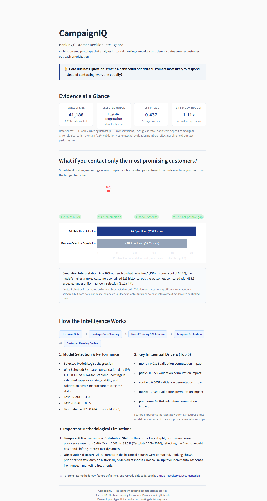

# CampaignIQ — Banking Customer Decision Intelligence

> **Smarter customer outreach through predictive analytics.**

CampaignIQ is an educational decision-intelligence prototype that analyzes historical retail banking marketing campaigns and demonstrates how pre-contact predictive prioritization compares with uniform random targeting.

---

## The Business Problem

Financial institutions invest substantial relationship manager and call-center resources contacting customers about term deposits and investment products. Contacting every customer uniformly is costly and generates client outreach fatigue. CampaignIQ addresses this inefficiency by estimating each customer's propensity to subscribe prior to initiating contact, allowing institutions to prioritize their most promising prospects under fixed operational outreach constraints.

---

## Project Preview



---

## Live Demo & Deployment

- **Local Execution:** Ready for immediate local execution via Streamlit (see [Run Locally](#run-locally)).
- **Cloud Deployment:** Pre-configured for zero-configuration deployment to [Streamlit Community Cloud](https://streamlit.io/cloud). All lightweight artifacts (`model.joblib`, `metrics.json`, `test_predictions.csv`, `feature_importance.csv`) are tracked in the repository so the app starts instantaneously without retraining.

---

## What I Built

1. **Leakage-Safe Ingestion Pipeline:** Automated ingestion and validation of the official 41,188-record UCI Bank Marketing dataset, strictly removing post-contact features (`duration`, `campaign`) to ensure 100% pre-contact feature validity.
2. **Chronological Splitting Strategy:** Evaluated on a strict chronological split (70% train / 15% validation / 15% test) that respects campaign chronology and exposes real-world macroeconomic regime shifts.
3. **Dual Model Benchmarking:** Implemented and compared an interpretable linear baseline (Regularized Logistic Regression) against a non-linear tree ensemble (HistGradientBoosting), selecting the champion via validation Average Precision and calibration error.
4. **Decision Intelligence Engine:** A reusable module (`src/decision_engine.py`) that translates prediction probabilities into outreach capacity decisions, calculating Precision-at-K, random baseline expectations, and Lift-at-K.
5. **Interactive Single-Page Application:** A minimalist financial-analytics dashboard built with Streamlit and Plotly that allows decision-makers to simulate varying outreach budgets and inspect model rationale.

---

## Key Experimental Results

All metrics reflect genuine model evaluation on the untouched, held-out chronological test cohort (6,179 customers):

| Evaluation Dimension | Metric | Score | Analytical Takeaway |
| :--- | :--- | :---: | :--- |
| **Ranking Efficiency** | **Average Precision (PR-AUC)** | **0.4371** | Primary metric; models ranking precision without majority-class distortion. |
| | **ROC-AUC** | **0.5592** | Global pairwise concordance across positive and negative pairs. |
| **Outreach Decision (20% Budget)** | **Customers Contacted ($K$)** | **1,236 / 6,179** | Selected top 20% by predicted subscription propensity. |
| | **Model Observed Positives** | **527** | Actual depositors identified in prioritized cohort (42.64% precision). |
| | **Random Expected Positives** | **475.3** | Positives expected under uniform random contact (38.45% baseline). |
| | **Outreach Lift** | **1.11x** | Concentrates deposits above random expectation under the same contact budget. |
| **Outreach Decision (5% Budget)** | **Precision-at-5% / Lift** | **51.46% / 1.34x** | At tightest capacity, delivers 1.34x concentration over baseline. |
| **Classification Benchmark** | **Balanced F1 Score** | **0.4844** | Precision: 45.16%, Recall: 52.23% (at validation-tuned threshold 0.696). |
| | **Naive Majority Accuracy** | **61.55%** | A naive zero-rule classifier achieves 61.55% accuracy while finding zero deposits. |
| **Calibration** | **Brier Score** | **0.3352** | Mean squared calibration error across probability output spectrum. |

---

## How It Works


---

## Run Locally

Tested on Windows 11 with Python 3.11–3.13.

### 1. Clone & Set Up Virtual Environment

```powershell
# Clone the repository
git clone https://github.com/your-username/CampaignIQ.git
cd CampaignIQ

# Create and activate virtual environment
python -m venv .venv
.\.venv\Scripts\Activate.ps1

# Install dependencies
pip install -r requirements.txt
```

### 2. Launch the Application

```powershell
streamlit run app.py
```
Open your browser at `http://localhost:8501`.

### 3. Optional: Reproduce All Models & Artifacts

To re-download the raw UCI data, re-train both models from scratch, evaluate test metrics, and regenerate all artifacts:

```powershell
python scripts/reproduce.py
```

### 4. Run Automated Test Suite

```powershell
python -m pytest
```

---

## Technical Methodology Summary

- **Feature Availability Point:** Modeled strictly prior to telephone contact. Demographic (`age`, `job`, `marital`), historical account (`poutcome`, `pdays`), and macroeconomic indicators (`euribor3m`, `cons.price.idx`) were included. Features occurring during or after the call (`duration`, `campaign`) were strictly excluded.
- **Chronological Split vs. Random K-Fold:** The dataset is chronologically ordered from May 2008 to November 2010. Chronological splitting avoids look-ahead contamination and exposed a dramatic macroeconomic regime shift: positive deposit rates rose from 5.57% (2008) to 38.45% (late 2010) as Euribor rates collapsed from 4.85% to <1.0% during the European debt crisis.
- **Algorithm Comparison:** Complex non-linear gradient boosting overfit the early macroeconomic regime, achieving only 0.1442 validation PR-AUC. Regularized Logistic Regression generalized significantly better (0.1870 validation PR-AUC, lower Brier score) and was selected as champion.
- **Decision Engine Formulas:**
  - $K = \text{round}(N \times \text{outreach\_ratio})$
  - $\text{Precision@K} = \frac{\text{Observed Positives in Top } K}{K}$
  - $\mathbb{E}[\text{Random Positives}] = K \times \text{Baseline Prevalence}$
  - $\text{Lift@K} = \frac{\text{Precision@K}}{\text{Baseline Prevalence}}$

*For complete mathematical formulations and error diagnostics, see [`docs/methodology.md`](docs/methodology.md).*

---

## Limitations

1. **Historical Portuguese Dataset:** Records originate from a Portuguese retail bank during the 2008–2010 financial crisis. Behavior and interest rate dynamics do not directly translate to modern markets (such as Indian retail banking) without domain-specific retraining.
2. **Observational Rather than Causal Uplift:** Every record in this dataset received a marketing call. The model estimates $P(Y=1 \mid X, \text{Contacted}=1)$. It demonstrates prioritization efficiency among historically contacted customers, but cannot prove causal incrementality (who subscribed *because* of the call) without randomized uncontacted holdout control groups.
3. **No Speculative Cost Claims:** Real-world banking deployment requires actual call center hourly wages, call duration distributions, and net interest margin (NIM) spreads. In the absence of primary financial cost data, speculative ROI estimates are intentionally avoided.

---

## Project Contribution

> Independent project focused on financial problem framing, analytical design, model evaluation, decision modelling, and product testing. Implementation developed with AI-assisted coding tools and validated through reproducible experiments.

---

## Technology Stack

- **Data Processing:** Python 3.13, Pandas, NumPy
- **Machine Learning & Pipelines:** Scikit-Learn (`Pipeline`, `ColumnTransformer`, `LogisticRegression`, `HistGradientBoostingClassifier`)
- **Decision Intelligence & Metrics:** Scikit-Learn, custom ranking engine (`src/decision_engine.py`)
- **Visualization & UI:** Streamlit, Plotly
- **Testing & Quality Assurance:** Pytest

---

## Dataset Attribution

Dataset: **UCI Machine Learning Repository — Bank Marketing Dataset**  
Authors: S. Moro, P. Cortez, and P. Rita (2014)  
DOI: [10.24432/C5K306](https://doi.org/10.24432/C5K306)  
License: Creative Commons Attribution 4.0 International (CC BY 4.0)

---

## Additional Documentation

- [Technical Methodology Documentation](docs/methodology.md)
- [Interview & Decision Management Guide](docs/interview_guide.md)
